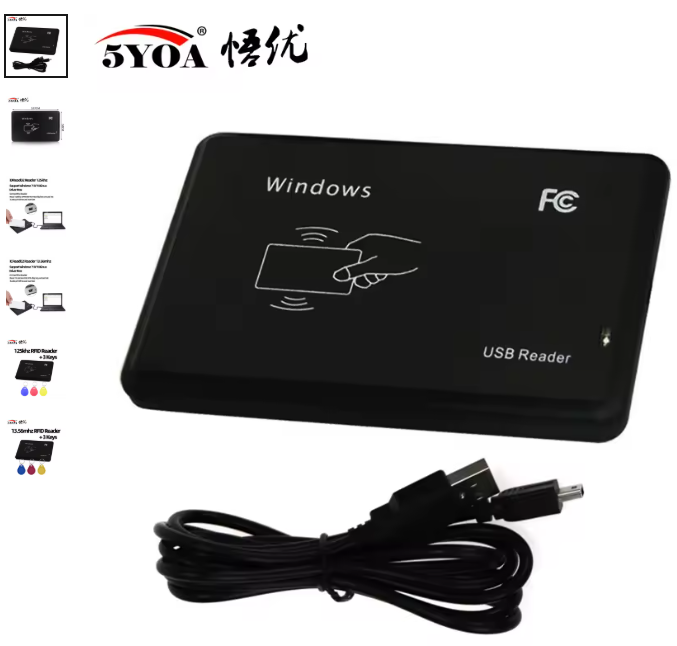

# USB RFID reader 1a86:2366 – output format tool for Linux



Command-line replacement for the Windows-only vendor tool
`只读改格式软件EN-Card_Reader.exe` ("USB Multi-function Card Reader Output Format
Setting Tool") of the cheap black, flat USB 125 kHz / 13.56 MHz RFID readers that
show up as:

```
ID 1a86:2366 QinHeng Electronics IC ID card reader
HID_NAME=Miao-Xiao-Zhi IC ID card reader
```

The reader works as a USB keyboard and types the card ID. With this tool you can
change the format of that ID (e.g. from 10-digit decimal to 10-digit hex, which shows
all 5 bytes of an EM4100 ID) on Linux. Python 3 is the only requirement, it uses
only the standard library. The setting is stored in the reader, so it works on any
computer afterwards.

## Hardware

What the reader looks like / how it is sold (from the product listing):

| | |
|---|---|
| Brand on listing | 5YOA (悟优) |
| Housing | black, flat, rectangular plastic box with rounded corners |
| Top print | "Windows", "FC" logo, card-and-hand symbol with RF waves, "USB Reader" |
| Indicator | one LED on the right side |
| Cable | USB-A to Mini-USB, black |
| Variants | ID reader 125 kHz (EM4100) and IC reader 13.56 MHz (Mifare), sold also as bundles with 3 key fobs |
| USB ID | `1a86:2366` QinHeng Electronics, HID name "Miao-Xiao-Zhi IC ID card reader" |
| Mode | USB HID keyboard emulation, driverless |

## Usage

```sh
python3 rfid_format.py                 # show current configuration
python3 rfid_format.py --hex10         # 10-digit hexadecimal (all 5 bytes)
python3 rfid_format.py --list          # list all format numbers
python3 rfid_format.py --regular 7     # 10-digit decimal (last 4 bytes)
python3 rfid_format.py --enter off     # no Enter after the ID
```

Options: `--regular N` (125 kHz EM/ID cards), `--ic N` (IC / Mifare cards),
`--hid N` (HID cards), `--enter`, `--wg-comma`, `--software-only` (on/off),
`--raw-flags`, `--probe` / `--probe-formats` (experiment with undocumented values).

### Permissions

The hidraw device is root-only by default. Either run with `sudo`, or install the
udev rule once:

```sh
sudo cp 99-rfid-reader.rules /etc/udev/rules.d/
sudo udevadm control --reload && sudo udevadm trigger
```

then replug the reader.

## Protocol

Reverse engineered from the .NET vendor tool. The reader has a second, vendor-defined
HID interface (usage page 0xFF00, 64-byte reports, no report IDs):

| Command | Request | Reply |
|---|---|---|
| query | `F1` | `F1 c0 c1 c2 c3 ver id[4]` |
| set   | `F2 c0 c1 c2 c3` | `F2 …` |

- `c0` – regular (125 kHz) format, 0–13 (0 = 10-digit hex)
- `c1` – IC-MF0 format, 0–5
- `c2` – HID card format, 0–3
- `c3` – flags: bit0 Enter, bit1 WG comma, bit7 output only to software (no keyboard)

## Known limitation: non-US keyboard layouts

The reader sends US keyboard scan codes, so on e.g. a Hungarian (or German, French…)
layout the digit `0` comes out as `ö` (or another character). There is no layout
or numpad setting: the unused flag bits 2–6 were tested and change nothing, and
format numbers above 13 are rejected. Fix it in the receiving application
(e.g. replace `ö` with `0`), or use a reader that supports layout selection.

## Files

- `rfid_format.py` – the Linux tool
- `99-rfid-reader.rules` – udev rule for non-root access
- `只读改格式软件EN-Card_Reader.exe` – the original Windows vendor tool (shipped with
  the reader), included for reference

---

## Magyarul

Linuxos parancssori program a 1a86:2366 azonosítójú fekete, lapos USB-s RFID
olvasóhoz, amellyel átállítható, milyen formátumban írja ki a kártya azonosítóját
(például `--hex10`: 10 jegyű hexadecimális, mind az 5 bájt). A beállítást az olvasó
eltárolja, így utána bármelyik gépen így működik.

Magyar billentyűzetkiosztásnál a `0` helyett `ö` jelenik meg. Az olvasóban erre
nincs beállítás, a fogadó alkalmazásban kell az `ö`-t `0`-ra cserélni.

Hardver: 5YOA (悟优) márkanéven árult fekete, lapos USB-olvasó, a tetején
„Windows”, „FC” és „USB Reader” felirat, egy LED, USB-A – Mini-USB kábel.
125 kHz-es (ID/EM4100) és 13,56 MHz-es (IC/Mifare) változatban, 3 kulcstartós
tag-gel is kapható.
